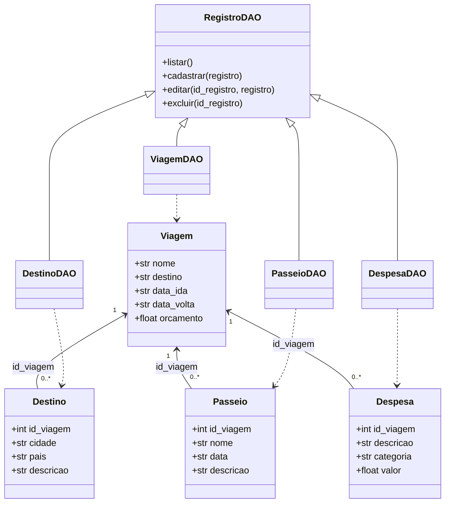

# Modelagem do TripPlan

## Diagrama de classes

Os modelos recebem os dados dos formulários. O SQLite gera a chave primária no cadastro. Cada DAO define como consultar seus registros e reutiliza as operações de gravação da classe RegistroDAO.

## Modelo lógico

| Tabela | Chave primária | Chave estrangeira | Outros campos |
|---|---|---|---|
| viagens | id_viagem | | nome, destino, data_ida, data_volta, orcamento |
| destinos | id_destino | id_viagem → viagens | cidade, pais, descricao |
| passeios | id_passeio | id_viagem → viagens | nome, data, descricao |
| despesas | id_despesa | id_viagem → viagens | descricao, categoria, valor |

Cada destino, passeio ou despesa pertence a uma viagem. A descrição de destinos e passeios é opcional. A consulta de viagens soma as despesas e a interface exibe o saldo do orçamento. Para excluir uma viagem, remova primeiro seus registros vinculados.

O [esquema SQLite](../database/banco.sql) contém os tipos, as restrições e os índices usados na execução.
